# Fitdee Research Paper Figures & Interface Gallery

This directory contains publication-ready architectural figures and high-resolution mobile application captures for research papers, presentations, and technical documentation.

---

## 1. System Architecture & Full-Stack Flow Chart

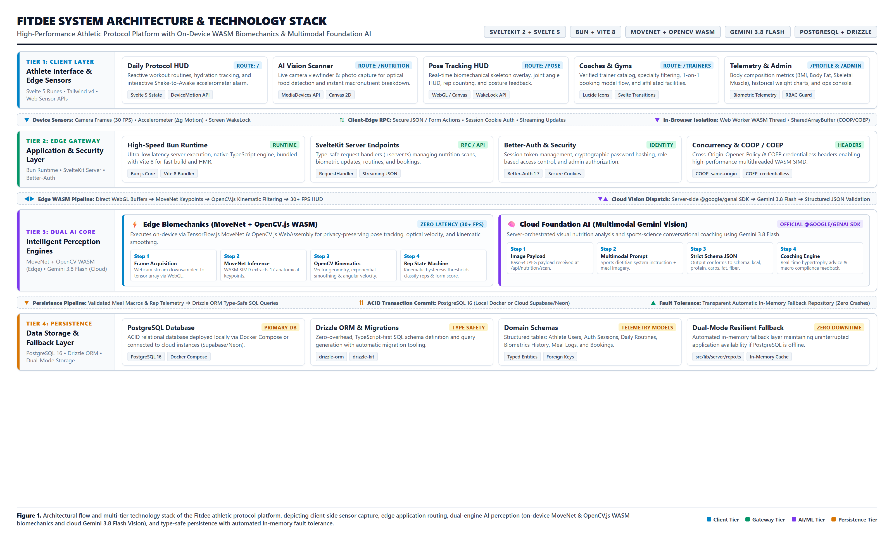

> **Figure 1: High-Level System Architecture and Multi-Tier Technology Stack of the Fitdee Athletic Protocol Platform.**  
> The diagram illustrates the 4-tier integrated topology:  
> 1. **Client & Sensor Tier:** Reactive Svelte 5 Runes interfaces leveraging HTML5 MediaDevices (camera), Accelerometer (DeviceMotion), and Screen WakeLock APIs.  
> 2. **Edge & Gateway Tier:** Ultra-fast Bun runtime with Vite 8 bundler, SvelteKit server endpoints, Better-Auth session security, and COOP/COEP isolation headers.  
> 3. **Dual-Engine AI Core:** Client-side zero-latency (30+ FPS) MoveNet + OpenCV.js WASM biomechanics (optical velocity vectoring, concentric/eccentric cadence, exponential jitter smoothing) paired with cloud-hosted Gemini 3.8 Flash Multimodal Vision via `@google/genai` for structured macro deconstruction and sports nutrition coaching.  
> 4. **Persistence & Telemetry Tier:** PostgreSQL 16 managed via Drizzle ORM schemas, backed by transparent in-memory fault-tolerant fallback execution.  
>  
> *Downloads: [High-Resolution PNG (3200×1920)](architecture-flow-stack.png) · [Scalable Vector SVG](architecture-flow-stack.svg)*

---

## 2. Mobile Application Interface Gallery (iPhone 16 Retina)

All screenshots were captured at native **iPhone 16 viewport specifications**:
- **Aspect Ratio**: `19.5:9` (`393:852`)
- **Logical Viewport**: `393 × 852` pt
- **Physical Retina Resolution (@3x DPR)**: `1179 × 2556` px

---

### Core Protocol & Daily Routine (`/`)

| Home Dashboard (`01-home.png`) | Workout Routine Checklist (`01-home-scrolled.png`) |
| :---: | :---: |
| [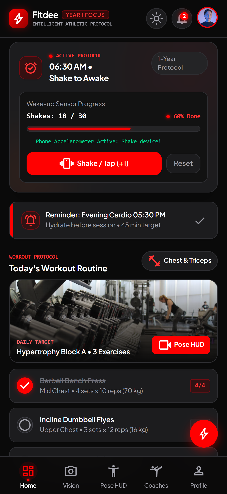](01-home.png) | [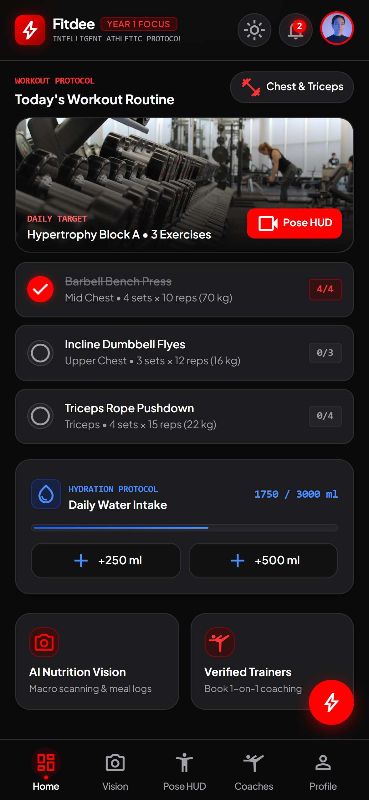](01-home-scrolled.png) |
| **Shake-to-Awake & Protocol Overview** Interactive accelerometer wake-up alarm progress (`18/30`), evening session reminder, and quick protocol shortcuts. | **Set Counters & Hydration HUD** Hypertrophy Block A exercise set checklist toggles, rest interval timer HUD, and quick hydration logging (`+250ml`, `+500ml`). |

---

### AI Nutrition Vision & Biometric Coach (`/nutrition`)

| AI Food Vision Scanner (`02-nutrition.png`) | AI Nutrition Coach (`02-nutrition-coach.png`) |
| :---: | :---: |
| [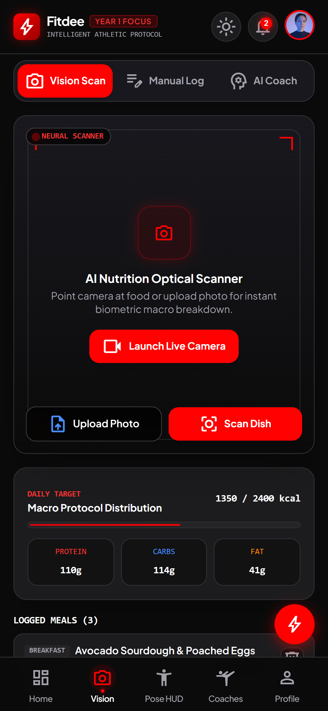](02-nutrition.png) | [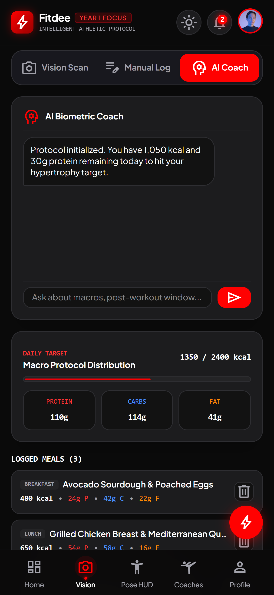](02-nutrition-coach.png) |
| **Multimodal Macro Deconstruction** Camera viewfinder and photo analyzer powered by Gemini 3.8 Flash. Deconstructs ingredients, calories, protein, carbs, and fats into strict JSON schema. | **Conversational Sports Dietitian** Real-time conversational AI coach delivering targeted nutrient timing, pre/post workout fuel recommendations, and muscle protein synthesis advice. |

---

### Real-Time MoveNet & OpenCV.js Optical Pose Tracking (`/pose`)

| Pose Tracking Setup (`03-pose.png`) | Active Biomechanical HUD (`03-pose-active.png`) |
| :---: | :---: |
| [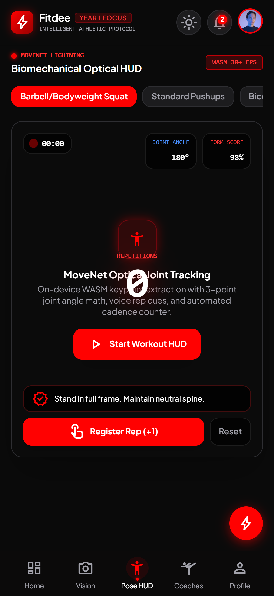](03-pose.png) | [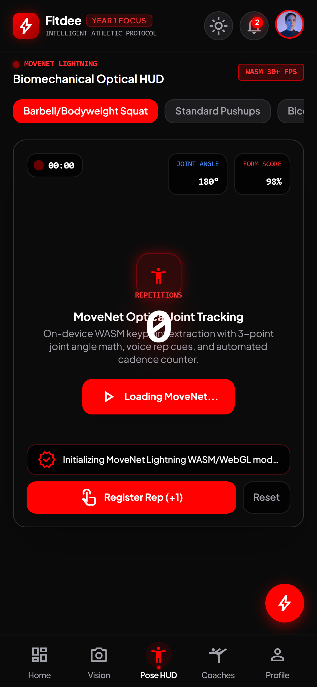](03-pose-active.png) |
| **Exercise Selector & Calibrator** Pre-workout camera reticle alignment, target exercise selector (Squats, Pushups, Lateral Raises), and privacy-first local WASM pipeline notice with client-side IndexedDB & Cache API model persistence. | **Real-Time Skeleton & Form HUD** 30+ FPS joint angle telemetry, OpenCV.js exponential jitter filtering, optical rep counter, dynamic form score (`98%`), and real-time posture correction cues. |

---

### Coaches & Performance Facilities (`/trainers`)

| Verified Trainer Catalog (`04-trainers.png`) | Partner Athletic Facilities (`04-trainers-gyms.png`) |
| :---: | :---: |
| [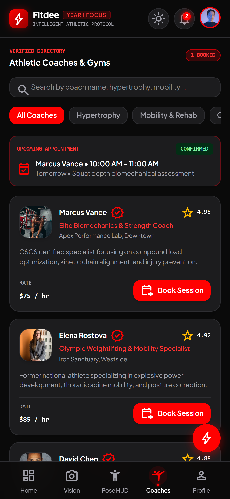](04-trainers.png) | [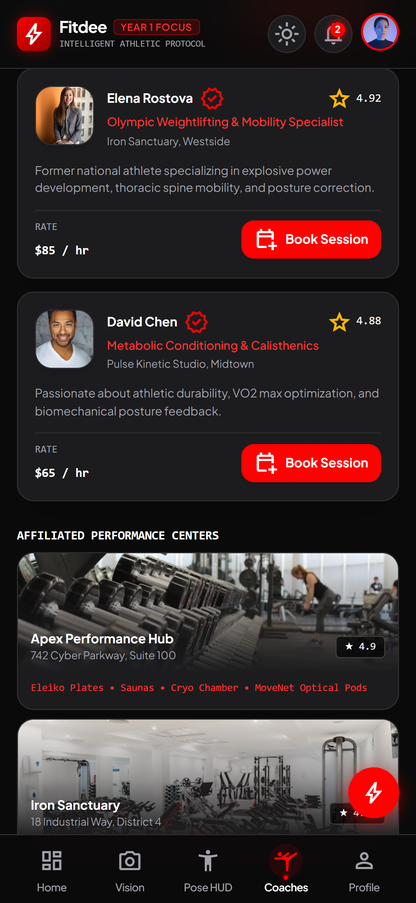](04-trainers-gyms.png) |
| **1-on-1 Coach Booking Directory** Filterable catalog of certified CSCS strength and conditioning coaches, specialty tags, hourly rates, and modal reservation system. | **Affiliated Training Facilities** Curated performance facilities and strength gyms with equipment specifications (Eleiko rigs, Olympic platforms, optical recovery pods). |

---

### Athlete Profile, Biometrics & Subscriptions (`/profile`)

| Biometric Telemetry (`05-profile.png`) | Progression Trends & Tier (`05-profile-measurements.png`) |
| :---: | :---: |
| [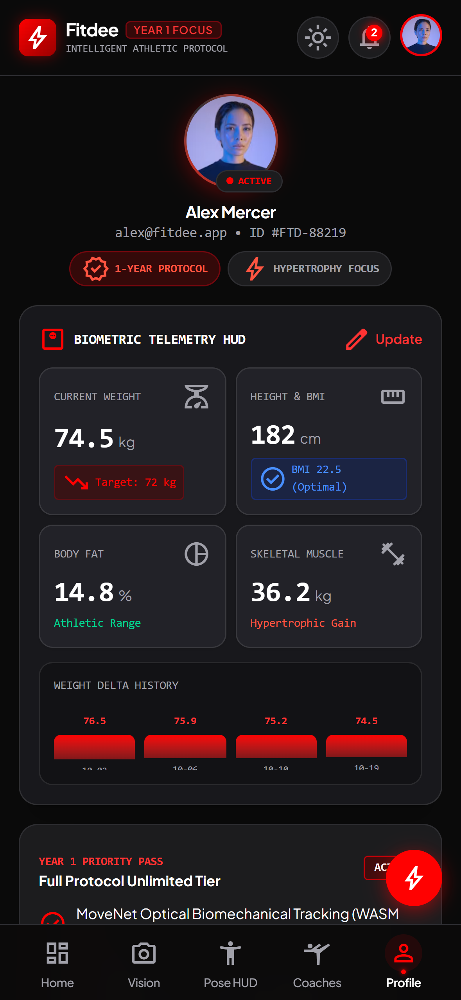](05-profile.png) | [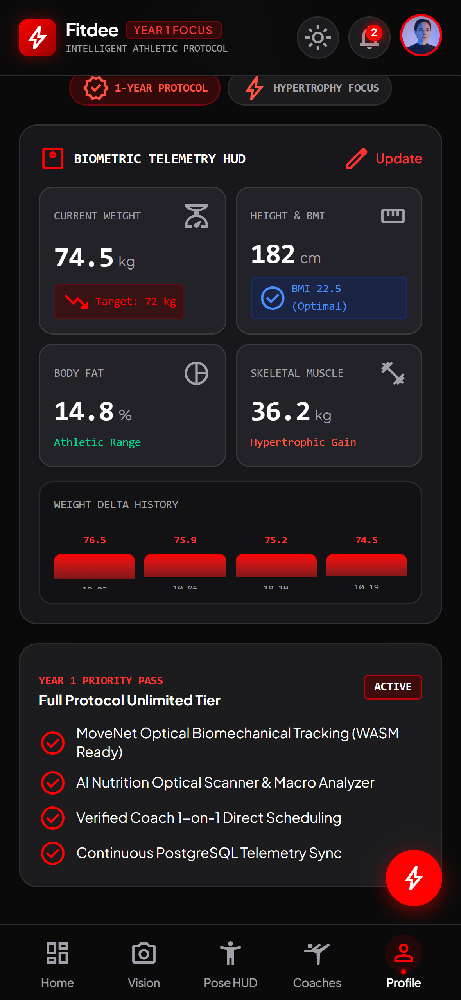](05-profile-measurements.png) |
| **4-Grid Biometric Cluster** Athlete telemetry displaying Weight, Height/BMI, Body Fat %, and Skeletal Muscle Mass with interactive biometric update modal. | **Weight Delta Progression** Historical progression timeline bar chart and Year 1 Priority Pass subscription tier overview. |

---

### Authentication & Ops Administration (`/login`, `/register`, `/admin`)

| Athlete Sign In (`06-login.png`) | Athlete Onboarding (`07-register.png`) | Diagnostic & Ops Console (`08-admin.png`) |
| :---: | :---: | :---: |
| [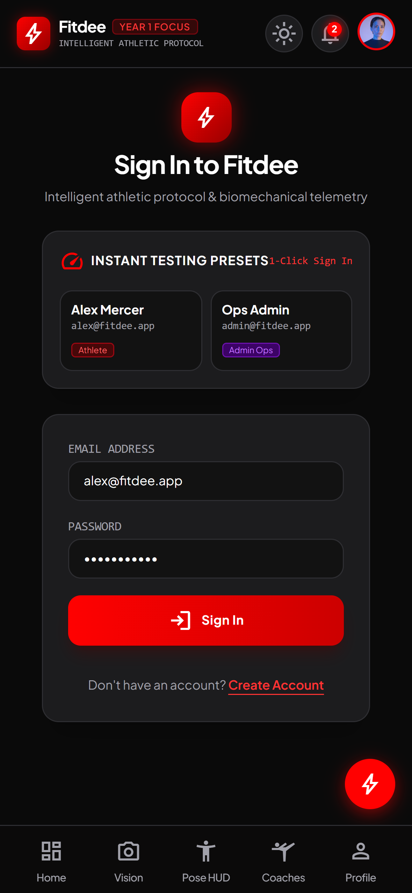](06-login.png) | [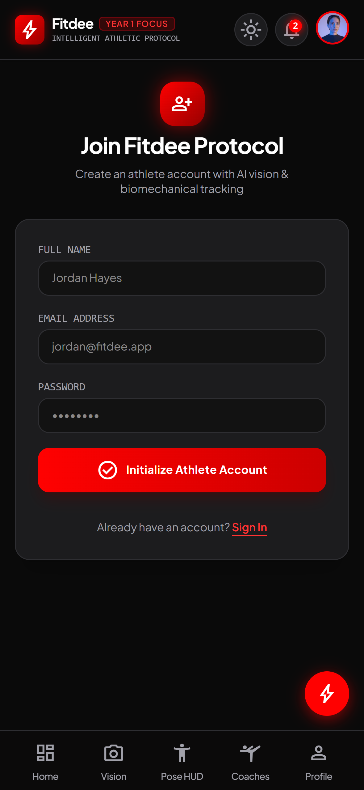](07-register.png) | [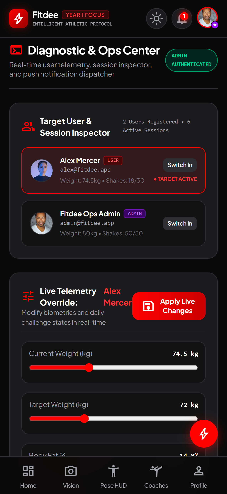](08-admin.png) |
| **Authentication Portal** 1-Click test athlete sign-in with Better-Auth session security. | **Registration Flow** New athlete onboarding and biometric initialization. | **Ops Telemetry Overrides** User state inspector, real-time telemetry overrides, and push notification dispatcher. |
